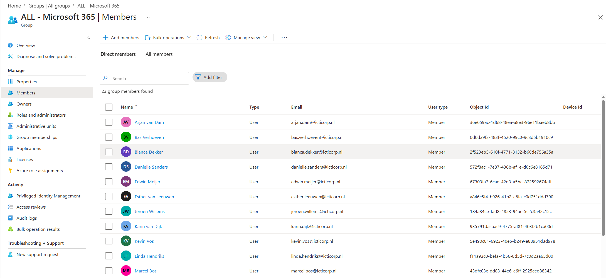
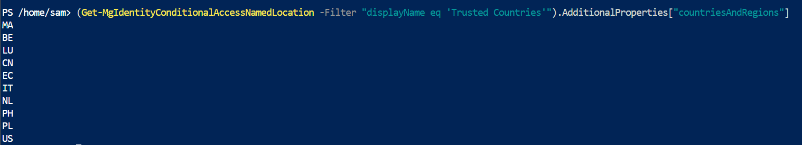
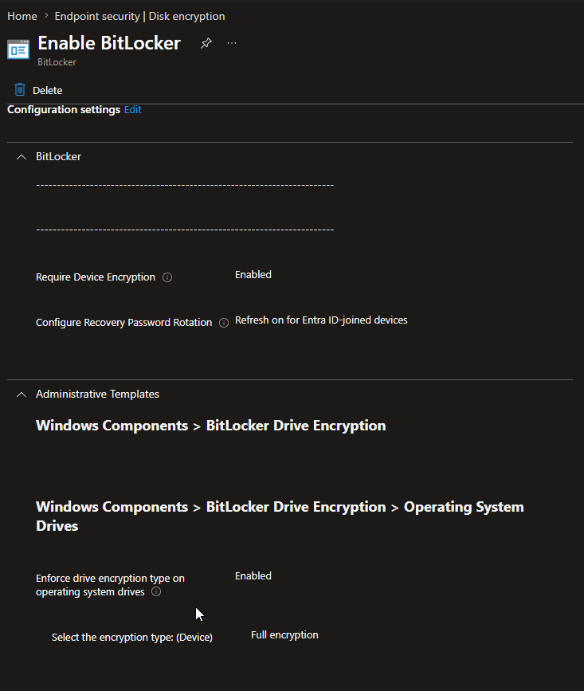

## 1. Licenties via een groep, niet per gebruiker

E5-licenties worden niet vanzelf toegekend. In plaats van ze per gebruiker toe te wijzen,
heb ik een groep gemaakt met alle gebruikers en de licentie aan die groep gekoppeld. Een
nieuwe medewerker krijgt zijn licentie dan door lid te worden van de groep, en wie de groep
verlaat verliest hem weer.

## 2. Eén naamconventie voor alles

Gebruikers en vergaderruimtes volgen hetzelfde patroon: `voornaam.achternaam@domein`. Dat
maakt adressen voorspelbaar, voor medewerkers en voor de beheerder.

## 3. Geo-blocking met een lijst van toegestane landen

In plaats van landen te blokkeren, heb ik een benoemde locatie *Trusted countries* gemaakt
met de tien landen waar medewerkers vandaan werken. Een Conditional Access-regel kan dan
alles blokkeren wat níet uit die lijst komt. Zo hoeft de lijst niet bij te houden welke
landen er allemaal bestaan. Met PowerShell heb ik gecontroleerd welke landcodes erin staan:

## 4. Een App Service in plaats van een virtuele machine

Voor een klein intern dashboard (de bestede uren uit ClickUp, met hulp van AI gemaakt) is
een hele VM te veel beheer. Een Azure App Service draait de applicatie zonder dat ik een
besturingssysteem hoef bij te werken. Inloggen loopt via Entra ID, zodat alleen
bedrijfsaccounts erbij kunnen.

## 5. Apps als Win32-pakket met een detectieregel

Voor de achtergrond en VMware Tools bestond geen kant-en-klaar sjabloon. Ik heb ze verpakt
met de Win32 Content Prep Tool en per app een detectieregel ingesteld, zodat Intune weet of
de installatie gelukt is. VMware Tools installeert stil met `/s`, zodat de gebruiker er
niets van merkt. Minimale versie voor beide: Windows 11 24H2, in lijn met de eis dat
apparaten bijgewerkt moeten zijn.

## 6. Aanbevelingen van Defender als Intune-profielen

Defender gaf per apparaat aanbevelingen. Die heb ik niet per apparaat opgelost, maar als
configuratieprofielen in Intune gezet, met de naam van de aanbeveling als profielnaam. Zo
staat alles op één plek en geldt het voor elk nieuw apparaat vanzelf. BitLocker is verplicht,
met de herstelsleutel opgeslagen in Entra ID.

