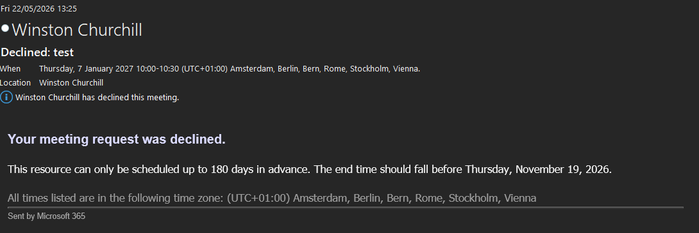
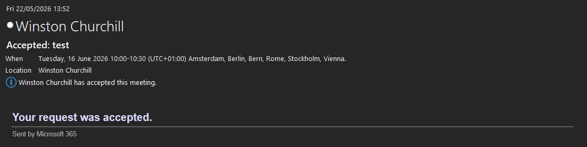
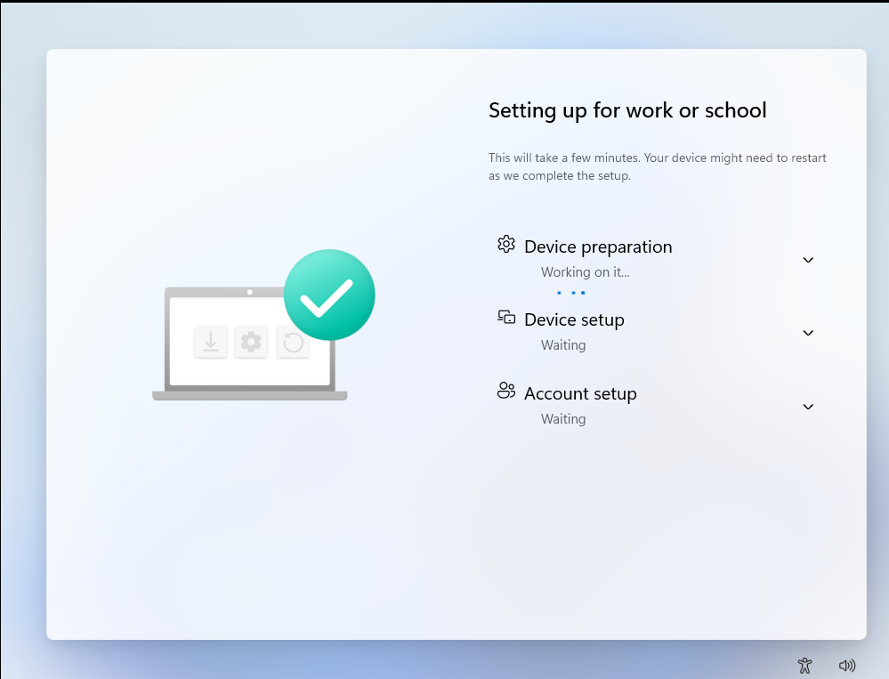
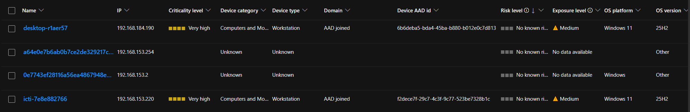

Ik heb per portal gewerkt, steeds voor mijn eigen vier afdelingen.

## 1. Domein

Het domein heb ik geregistreerd en de DNS ondergebracht bij Cloudflare, dat verkeer filtert
voordat het de site bereikt. Daarna is het domein aan de tenant gekoppeld.

## 2. Entra ID

- Vier afdelingsgroepen met elk drie gebruikers.
- MFA aan voor alle gebruikers; bij elke gebruiker staat de Authenticator-app gekoppeld
  (status *enforced*).
- Licenties via een groep (zie [beslissingen](/m365-stage/beslissingen/)).

## 3. Exchange Online

**Gedeelde mailboxen.** Per afdeling een gedeelde mailbox, waarbij de leden *Send As* en
*Read and manage* hebben. Test: mezelf toegevoegd aan de mailbox van Sales en een mail
gestuurd. Die kwam binnen in de gedeelde mailbox.

**Vergaderruimtes.** Vier ruimtes met dezelfde regels:

| Regel | Waarde |
|---|---|
| Maximaal vooruit plannen | 180 dagen |
| Maximale duur | 4 uur |
| Alleen tijdens werkuren | Ja |
| Herhalende afspraken | Toegestaan |

| Test | Verwacht | Resultaat |
|---|---|---|
| Afspraak verder dan 180 dagen vooruit | Geweigerd | Geslaagd |
| Afspraak langer dan 4 uur | Geweigerd, omdat hij te lang is | Eerst geweigerd met de verkeerde reden; zie [storingen](/m365-stage/storingen/) |
| Afspraak binnen de regels | Geaccepteerd | Geslaagd |

## 4. SharePoint en Teams

Per afdeling een SharePoint-site op basis van het sjabloon *Project management*, met de
naam van de afdeling. Via *Add Teams* is aan elke site direct een team gekoppeld.

## 5. Azure

- Benoemde locatie *Trusted countries* voor geo-blocking.
- Het urendashboard als App Service, met inloggen via Entra ID. Dat werkte pas na drie
  problemen; zie [storingen](/m365-stage/storingen/).

## 6. Intune en Autopilot

| App | Hoe | Voor wie |
|---|---|---|
| Microsoft 365-apps | Sjabloon in Intune | Alle gebruikers, verplicht |
| Bedrijfsportal | Microsoft Store-app | Alle gebruikers, verplicht |
| Achtergrond | Win32-pakket plus configuratieprofiel | Alle gebruikers |
| VMware Tools | Win32-pakket, stille installatie | Alle apparaten |

VMware Tools stond erbij omdat we op virtuele machines testten. Bij elke wipe verdween het,
en zo kwam het automatisch terug.

**Autopilot.** Een apparaat dat al in Intune bekend is, krijgt via een groepstag een
Autopilot-profiel. De gebruiker hoeft dan alleen in te loggen; tijdens het inrichten ziet hij
een voortgangsscherm.

## 7. Defender en beveiliging

- **Defender for Endpoint.** Aangesloten via de koppeling tussen Defender en Intune, plus een
  configuratieprofiel dat de apparaten aanmeldt. Daarna verschenen ze in de Defender-portal.
- **Aanbevelingen** doorgevoerd als Intune-profielen (zie [beslissingen](/m365-stage/beslissingen/)).
- **BitLocker** verplicht, met de herstelsleutel in Entra ID.
- **USB-opslag** geblokkeerd, volgens de eis dat er geen externe schijven op mogen.

