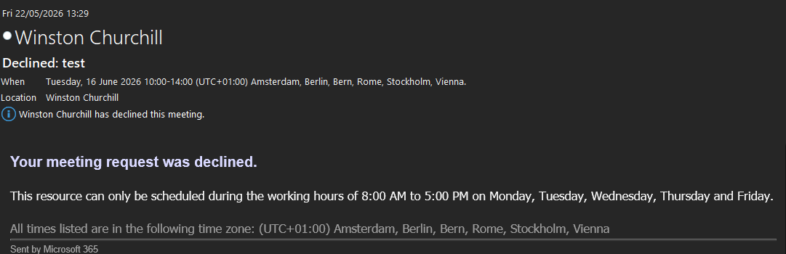
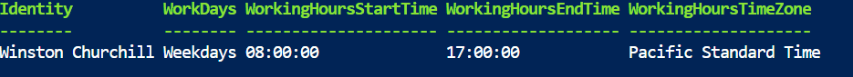
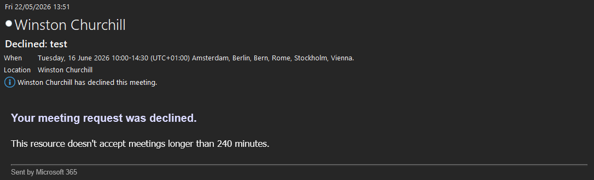
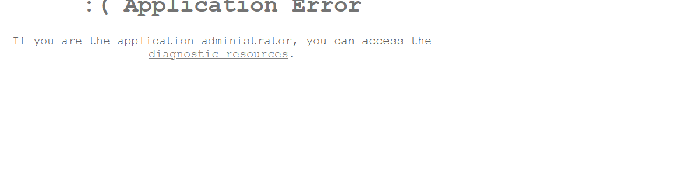
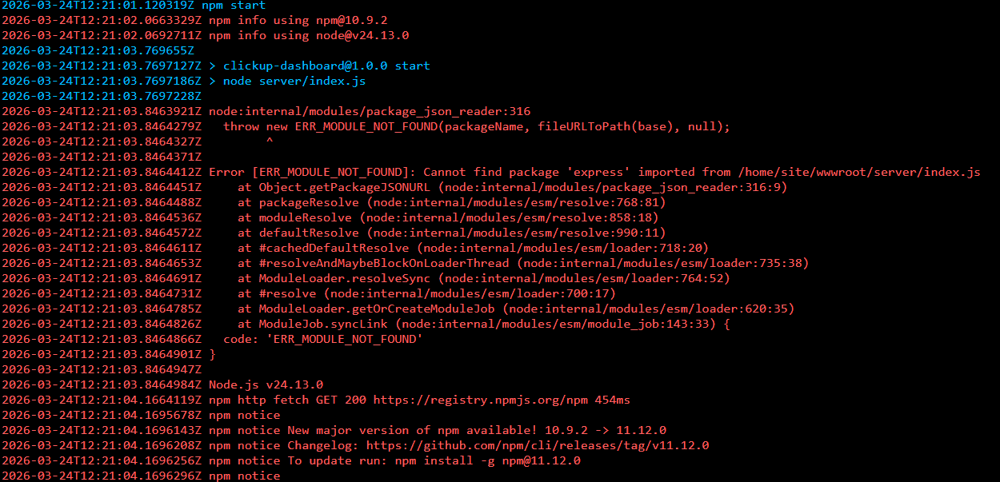

## 1. Vergaderruimte weigerde met de verkeerde reden

**Symptoom.** Een afspraak van langer dan 4 uur werd terecht geweigerd, maar met de melding
dat de afspraak buiten de werkuren viel. Dat klopte niet: de afspraak lag midden op een
werkdag.



**Oorzaak.** Twee dingen. De mailbox van de ruimte had geen tijdzone, dus wist hij niet wat
"werkuren" betekende. En de werkuren zelf stonden in een andere tijdzone:



**Herstel.** De tijdzone van de mailbox én die van de werkuren gezet. Dat zijn twee aparte
commando's:

```powershell
Set-MailboxRegionalConfiguration -Identity winston.churchill@icticorp.nl -TimeZone "Central European Standard Time"
Set-MailboxCalendarConfiguration -Identity winston.churchill@icticorp.nl -WorkingHoursTimeZone "Central European Standard Time"
```

Daarna weigerde de ruimte de afspraak met de juiste reden:



**Les.** Dat een test "geslaagd" lijkt omdat het resultaat klopt, zegt niets als de reden
niet klopt. Lees de melding, niet alleen de uitkomst.

## 2. App Service toonde het dashboard niet

**Symptoom.** Na het uploaden bleef de standaardpagina van Azure staan, en later verscheen
*Application Error*.



Drie oorzaken, de een na de ander:

1. **Bestanden in de verkeerde map.** Azure serveert alleen uit `wwwroot`. Na het verplaatsen
   verscheen de foutpagina.
2. **Ontbrekende Node-modules.** Het log liet zien dat `express` niet gevonden werd:

   

   De modules waren niet mee geïnstalleerd. Na een `npm install` kwam de applicatie verder.
3. **Ontbrekende instellingen.** Het dashboard vroeg om een team-ID en API-sleutel van
   ClickUp. Die heb ik als omgevingsvariabelen in de App Service gezet, niet in de code.

Daarna werkte het dashboard, en heb ik inloggen via Entra ID aangezet.

## 3. Achtergrond instellen via een script werkte niet

**Doel.** Een vaste achtergrond op alle laptops.

**Eerste poging.** Een PowerShell-script, met hulp van AI geschreven, dat de achtergrond via
het register instelt. Dat werkte niet: de app installeerde eerst als gebruiker, terwijl het
script als beheerder draaide en dus een ander deel van het register zag. Ook op systeemniveau
werkte het script niet.

**Oplossing.** Geen script, maar een *Administrative Template* in een Intune-
configuratieprofiel. Het Win32-pakket zet de afbeelding op een vaste plek
(`C:\Users\Public\Pictures`), en het profiel stelt die in als achtergrond.

**Les.** Zoek eerst of Intune een instelling ervoor heeft, voordat je een script schrijft.
Dat is beter te beheren en beter te controleren.

## 4. Defender bleek geen app te zijn

Ik ging ervan uit dat Defender for Endpoint als app uitgerold moest worden. Dat bleek niet
zo: een apparaat sluit je aan via de koppeling tussen Defender en Intune, plus een
configuratieprofiel dat de apparaten aanmeldt. De app die ik eerst had uitgerold, was
daarvoor niet nodig.
