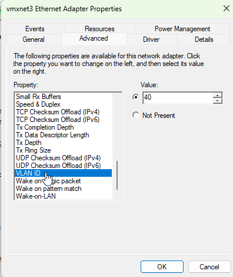
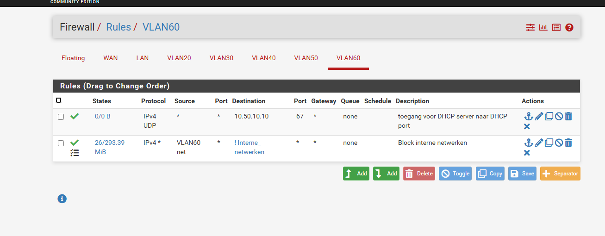
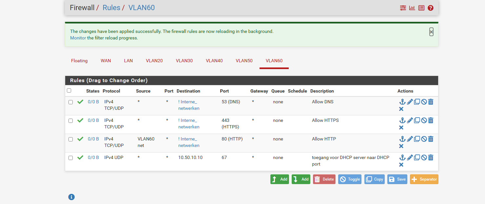

Per keuze: wat ik koos, en waarom.

## 1. pfSense routeert en filtert tussen alle VLAN's

Alle VLAN's komen samen op één trunk naar pfSense. Daardoor gaat elk pakket tussen twee
afdelingen langs de firewall, en staan alle regels op één plek. Het nadeel is dat pfSense
een single point of failure is: valt hij uit, dan valt al het verkeer tussen VLAN's en
naar internet weg.

## 2. VLAN-tags op de netwerkkaart van de test-VM's

VMware Workstation heeft geen managed switch. Om een test-VM in een VLAN te zetten, heb ik
in Windows op de netwerkkaart (vmxnet3) het VLAN-ID ingesteld. De VM tagt zijn verkeer dan
zelf, en pfSense ziet het op de juiste VLAN-interface binnenkomen.



Voor een test werkt dat, maar in een echt netwerk zou het een zwakte zijn: wie het VLAN-ID
aanpast, zit in een ander netwerk. Daar bepaalt de switchpoort het VLAN, of in dit geval de
access point via het SSID. In [Verbeek Logistiek](/verbeek-logistiek/) bouw ik het daarom
wel met een switch en access ports.

## 3. DHCP op de Windows-server, via een relay op pfSense

De opdracht vroeg om DHCP vanaf de Windows-server. Die staat in VLAN 10, en een
DHCP-aanvraag komt niet vanzelf over de grens van een VLAN. pfSense stuurt de aanvragen
daarom door naar DC1 (10.50.10.10). Per VLAN is er een eigen scope met de eigen gateway.

## 4. NPS als RADIUS-server

NPS draait op dezelfde server als Active Directory. Een beleid controleert of een
gebruiker lid is van de juiste groep, zoals `GRP-wifi-Medical`, zonder koppeling naar
een aparte server. De UniFi-controller is de enige toegestane RADIUS-client, met een
gedeeld geheim.

## 5. Eén AD-groep per SSID

Toegang gaat via groepslidmaatschap, niet via losse accounts. Een nieuwe arts krijgt
wifi door hem in `GRP-wifi-Medical` te zetten; wie de groep verlaat, komt er bij de
volgende inlog niet meer in.

## 6. WPA2-PSK voor medische apparaten

Veel infuuspompen en monitors ondersteunen geen 802.1X. De opdracht stond daarom een
sterke PSK toe voor dit netwerk. Het SSID is ook verborgen, maar dat is geen beveiliging:
het houdt het netwerk alleen uit de lijst. De bescherming zit in de PSK en in de
firewall, die VLAN 40 alleen naar de medische database laat.

## 7. Eén alias voor alle interne netwerken

Regels naar internet zeggen: alles mag, behalve een adres in *Interne netwerken*
(10.50.0.0/16). Komt er later een VLAN bij, dan valt die vanzelf onder de blokkade. Ik
kwam bij deze opzet uit na een regel die niet werkte; zie
[Storingen en beperkingen](/medica-plus/storingen/).

## 8. Gasten alleen DNS, HTTP en HTTPS

Eerst mochten gasten alles naar internet. Ik heb dat teruggebracht naar drie poorten:
53 (DNS), 80 (HTTP) en 443 (HTTPS). Dat is genoeg om te browsen en sluit de rest af.





## 9. Zabbix mag alleen twee vaste commando's uitvoeren

Om diensten automatisch te herstarten, moet de Zabbix-agent op DC1 commando's mogen
uitvoeren. Dat is een risico: wie Zabbix overneemt, kan dan alles op de domain
controller. Daarom staat de agent alleen het herstarten van DNS en NPS toe, en weigert
hij al het andere:

```ini
AllowKey=system.run[*net start dns*]
AllowKey=system.run[*net start DNS*]
AllowKey=system.run[*net start ias*]
AllowKey=system.run[*net start IAS*]
DenyKey=system.run[*]
```

De volgorde telt: Zabbix kijkt van boven naar beneden en de eerste regel die past, wint.
Daarom staat de weigerregel onderaan.
