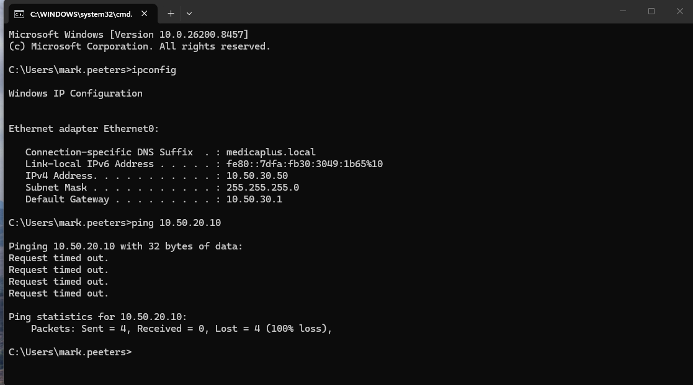
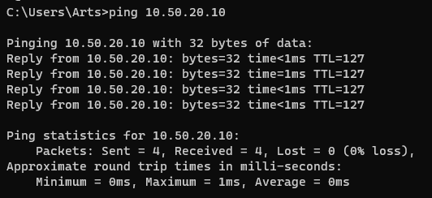
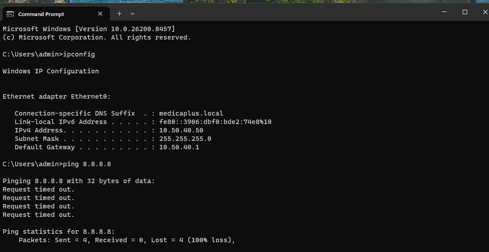
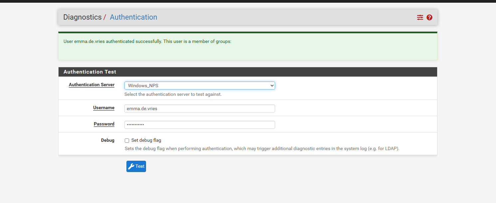
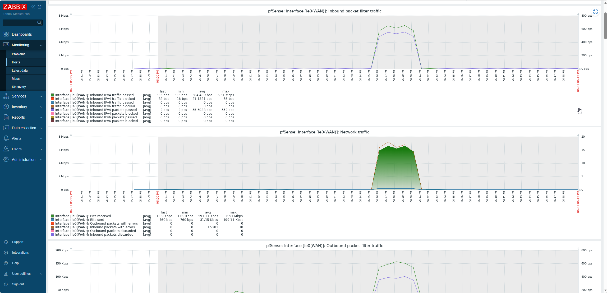

Ik heb in vier stappen gebouwd: eerst de firewall, dan de server met AD en RADIUS, dan de
wireless controller, en tot slot monitoring. Elke stap had een eigen testplan.

## 1. pfSense

Twee netwerkkaarten: één naar internet (WAN), één als trunk waarop de zes VLAN's hangen.
Elk VLAN kreeg een interface met het gateway-adres uit het [ontwerp](/medica-plus/ontwerp/),
een DHCP-relay naar DC1, en eigen firewallregels.

| Test | Verwacht | Resultaat |
|---|---|---|
| Ping van Administratie naar de medische database (10.50.20.10) | Geblokkeerd | Geslaagd |
| Ping van een medisch apparaat naar de medische database | Bereikbaar | Geslaagd |
| Ping van een medisch apparaat naar 8.8.8.8 | Geblokkeerd | Geslaagd |
| Internet vanuit het medische VLAN | Werkt | Geslaagd, na een correctie in de regels |

## 2. Windows Server 2025

DC1 werd domain controller voor `medicaplus.local`, met DNS, DHCP en NPS. Ik maakte twee
OU's voor groepen en gebruikers, drie wifi-groepen, en per groep een testgebruiker. In NPS
staat de UniFi-controller als RADIUS-client, met een beleid per groep voor draadloze
aanvragen.

| Test | Verwacht | Resultaat |
|---|---|---|
| Client in VLAN 20 krijgt een adres via DHCP | Adres uit de scope, DNS 10.50.10.10 | Geslaagd |
| AD-gebruiker uit `GRP-wifi-Medical` logt in via RADIUS | NPS accepteert | Geslaagd via de testfunctie van pfSense (zie beperkingen) |

## 3. UniFi Network Server

Op een Ubuntu-VM draait de UniFi Network Server. Ik koppelde de RADIUS-server, maakte per
VLAN een netwerk aan, en daarop de vijf SSID's. Het gastennetwerk werd een hotspot met
captive portal: naam en e-mail verplicht, sessie van 4 uur, 5 Mbit/s download en 2 Mbit/s
upload per gast, en gasten kunnen elkaar niet zien. De minimale bitrate staat op 12 Mbps
voor Medical en 6 Mbps voor Gasten, zodat apparaten sneller naar een dichterbij access
point gaan.

Zonder access points kon de controller deze instellingen nog niet uitrollen. Ze staan klaar
voor zodra er hardware is.

## 4. Zabbix

Zabbix draait op Ubuntu met MySQL. Het leest pfSense uit via SNMP, DC1 via de
Zabbix-agent, en de UniFi-controller via HTTP. Voor DNS en NPS op DC1 zijn er triggers met
hoge prioriteit.

| Test | Verwacht | Resultaat |
|---|---|---|
| Webinterface bereikbaar | Laadt | Geslaagd |
| pfSense via SNMP | CPU en verkeer per interface zichtbaar | Geslaagd |
| Agent op DC1 | Data komt door de Windows-firewall heen | Geslaagd |
| UniFi via HTTP | Data komt binnen | Geslaagd |
| NPS-dienst stoppen | Alarm met hoge prioriteit | Geslaagd, alarm na 6 seconden |

Daarna heb ik Zabbix uitgebreid met automatisch herstel: stopt DNS of NPS, dan start Zabbix
de dienst zelf opnieuw. Dat werkte pas bij de derde poging; zie
[Storingen en beperkingen](/medica-plus/storingen/).
