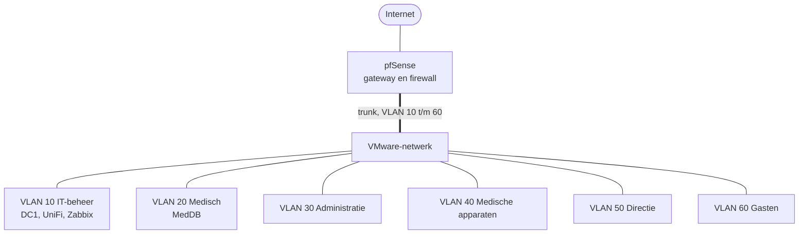

Alles loopt via één trunk naar pfSense, die tussen de zes VLAN's routeert en per VLAN
bepaalt wat er mag. De servers staan in het IT-beheer-VLAN, de medische database in het
medische VLAN.

## Netwerktekening

## VLAN's

| VLAN | Naam | Subnet | Gateway | SSID | Beveiliging |
|---|---|---|---|---|---|
| 10 | IT-beheer | 10.50.10.0/24 | 10.50.10.1 | geen | bekabeld |
| 20 | Medisch | 10.50.20.0/23 | 10.50.20.1 | MedicaPlus-Medical | WPA2-Enterprise |
| 30 | Administratie | 10.50.30.0/24 | 10.50.30.1 | MedicaPlus-Admin | WPA2-Enterprise |
| 40 | Medische apparaten | 10.50.40.0/24 | 10.50.40.1 | MedicaPlus-Devices (verborgen) | WPA2-PSK |
| 50 | Directie | 10.50.50.0/24 | 10.50.50.1 | MedicaPlus-Management (verborgen) | WPA2-Enterprise |
| 60 | Gasten | 10.50.60.0/23 | 10.50.60.1 | MedicaPlus-Gasten | Open met captive portal |

Medisch en Gasten hebben een /23 (ruim 500 adressen), omdat de opdracht uitging van 250+
apparaten bij het personeel en 200 gelijktijdige gasten. Een /24 heeft er maar 254.

## Servers

| Naam | Systeem | Adres | Rol |
|---|---|---|---|
| pfSense | pfSense | 10.50.10.1 | Gateway, firewall, DHCP-relay |
| DC1 | Windows Server 2025 | 10.50.10.10 | Domain controller (medicaplus.local), DNS, DHCP, NPS |
| Zabbix | Ubuntu | 10.50.10.15 | Monitoring |
| UniFi-SRV | Ubuntu | 10.50.10.20 | UniFi Network Server |
| MedDB | Windows 11 | 10.50.20.10 | Medische database (gesimuleerd) |

## Wie mag waarheen

| Van | Internet | Medische database | Andere VLAN's |
|---|---|---|---|
| Medisch (20) | Ja | Ja | Nee |
| Administratie (30) | Ja | Nee | Nee |
| Medische apparaten (40) | Nee | Ja | Nee |
| Directie (50) | Ja | Ja | Ja |
| Gasten (60) | Alleen DNS, HTTP en HTTPS | Nee | Nee |

Medisch en Administratie mogen daarnaast naar DC1 voor inloggen en tijd. Elke regel die
naar het internet leidt, gebruikt de alias *Interne netwerken* (10.50.0.0/16) met
*invert match*: alles mag, behalve een intern adres. Waarom dat zo moest, staat bij
[Storingen en beperkingen](/medica-plus/storingen/).
