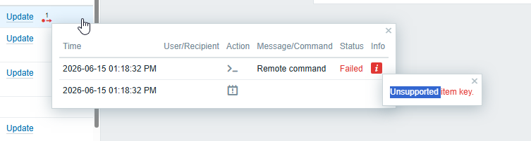
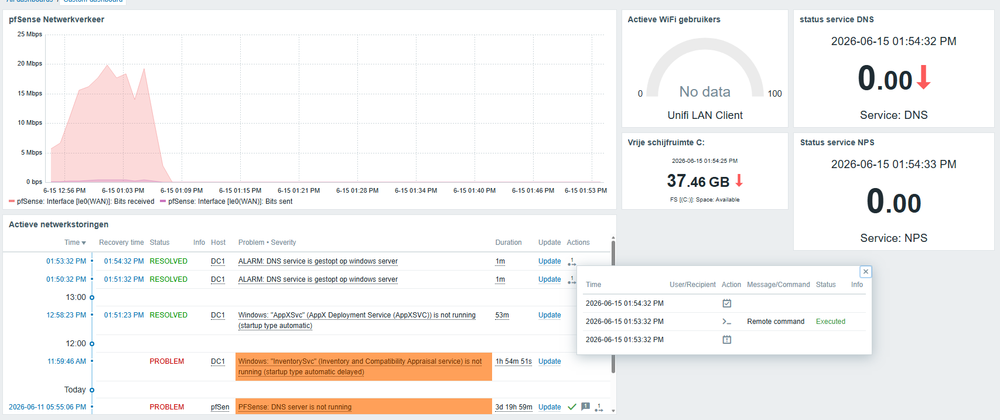

Twee dingen werkten niet bij de eerste poging, en twee tests kon ik in VMware niet
uitvoeren zoals bedoeld.

## Medisch VLAN had geen internet

**Symptoom.** Na het instellen van de firewallregels kon het medische VLAN het internet
niet op, terwijl de regel "naar internet toestaan" er wel stond.

**Oorzaak.** Als bestemming had ik *WAN net* gekozen. Dat is niet "het internet", maar
alleen het subnet waarin het WAN-adres van pfSense zelf ligt. Verkeer naar bijvoorbeeld
8.8.8.8 viel daar buiten en werd dus niet toegestaan.

**Oplossing.** De bestemming werd de alias *Interne netwerken* (10.50.0.0/16), met
*invert match*. De regel betekent nu: alles mag, behalve een intern adres. Daarna slaagden
alle tests.

## Automatisch herstel in Zabbix werkte pas bij de derde poging

**Doel.** Stopt de DNS- of NPS-dienst op DC1, dan start Zabbix hem zelf weer.

**Poging 1.** In de agentconfiguratie op DC1 stonden deze regels:

```ini
AllowKey=system.run[net start DNS]
AllowKey=system.run[net start IAS]
DenyKey=system.run[*]
```

Bij het testen faalde het commando met *Unsupported item key*.



**Poging 2.** Zabbix kan extra tekst meesturen, dus ik voegde een `*` toe aan de regel.
Zelfde foutmelding.

**Onderzoek.** Tijdelijk heb ik *alle* commando's toegestaan (`AllowKey=system.run[*]`). Toen
werkte het wel, dus het lag aan mijn regel en niet aan Zabbix. Met logging aan zag ik welk
commando de agent precies ontving:

```txt
2884:20260615:154511.808 Executing command 'net start dns'
```

**Oorzaak.** Zabbix stuurde `dns` in kleine letters, mijn regel had `DNS`. De regel paste
dus nooit.

**Oplossing.** Ik heb regels toegevoegd die beide schrijfwijzen toestaan (zie
[beslissing 9](/medica-plus/beslissingen/#9-zabbix-mag-alleen-twee-vaste-commandos-uitvoeren))
en de tijdelijke regel die alles toestond uitgeschakeld. Daarna werkte het voor DNS en
voor NPS: de dienst stopt, het alarm komt binnen, en binnen een minuut staat het probleem
op opgelost.



**Les.** Een tijdelijke regel die alles toestaat is een goede manier om te testen waar een
probleem zit, maar alleen als je hem direct weer weghaalt.

## Beperking: geen echte wifi in VMware

Zonder access points kan geen enkele VM met een SSID verbinden. Twee tests heb ik daarom
anders uitgevoerd:

- **802.1X-inlog.** In plaats van inloggen vanaf een laptop heb ik met de
  authenticatietest van pfSense gecontroleerd of NPS een gebruiker uit de juiste AD-groep
  accepteert. Dat bewijst dat AD, NPS en het beleid kloppen, maar niet dat de hele keten
  via een access point werkt.
- **Captive portal.** De portal zelf was niet te zien. Wel heb ik getest dat een client in
  VLAN 60 internet heeft en geen interne adressen bereikt.
