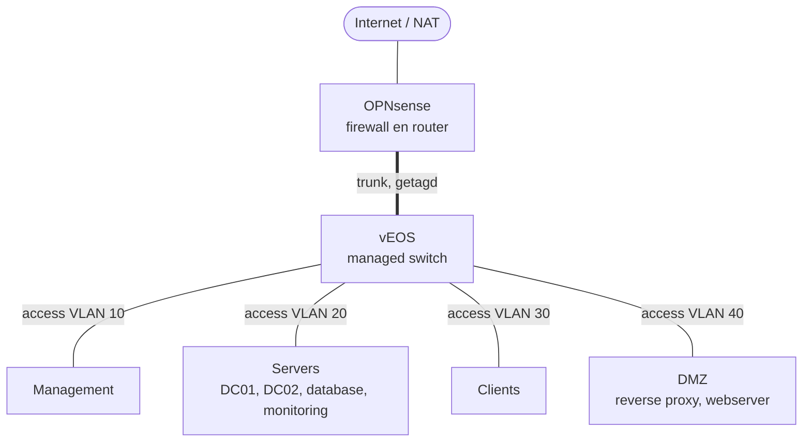

:::caution[Concept]
Deze pagina is een voorstel en staat op `draft: true`. Controleer en herschrijf hem
op basis van wat je werkelijk bouwt, en haal dan de regel `draft: true` weg.
:::

## Netwerktekening

## VLAN-indeling

| VLAN | Naam | Subnet | Gateway | Doel |
|---|---|---|---|---|
| 10 | Management | 10.10.10.0/24 | 10.10.10.1 | Beheer van firewall en switch |
| 20 | Servers | 10.10.20.0/24 | 10.10.20.1 | DC's, database, monitoring, back-up |
| 30 | Clients | 10.10.30.0/24 | 10.10.30.1 | Werkplekken |
| 40 | DMZ | 10.10.40.0/24 | 10.10.40.1 | Reverse proxy en webserver |

## Resourceverdeling

| VM | RAM | Altijd aan |
|---|---|---|
| OPNsense | 1 GB | Ja |
| vEOS-switch | 2 GB | Ja |
| DC01, DC02 (Server Core) | 2 GB elk | Ja |
| Webserver | 2 GB | Ja |
| Database | 4 GB | Ja |
| Monitoring | 2 GB | Ja |
| Windows-client | 4 GB | Alleen bij testen |
| Back-upserver | 4 GB | Alleen bij back-up en restore |
