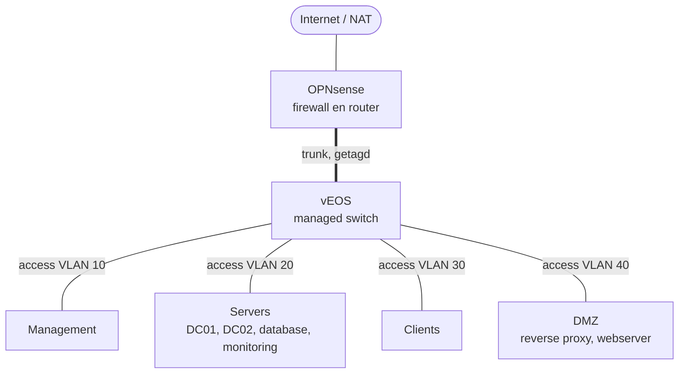

import VlanTabel from '../../../components/VlanTabel.astro';
import MachineTabel from '../../../components/MachineTabel.astro';
import GeheugenBalk from '../../../components/GeheugenBalk.astro';

:::caution[Concept]
Deze pagina is een voorstel en staat op `draft: true`. Controleer en herschrijf hem
op basis van wat je werkelijk bouwt, en haal dan de regel `draft: true` weg.
:::

## Netwerktekening

## VLAN-indeling

<VlanTabel />

## Machines

<MachineTabel />

## Geheugenverdeling

<GeheugenBalk />
